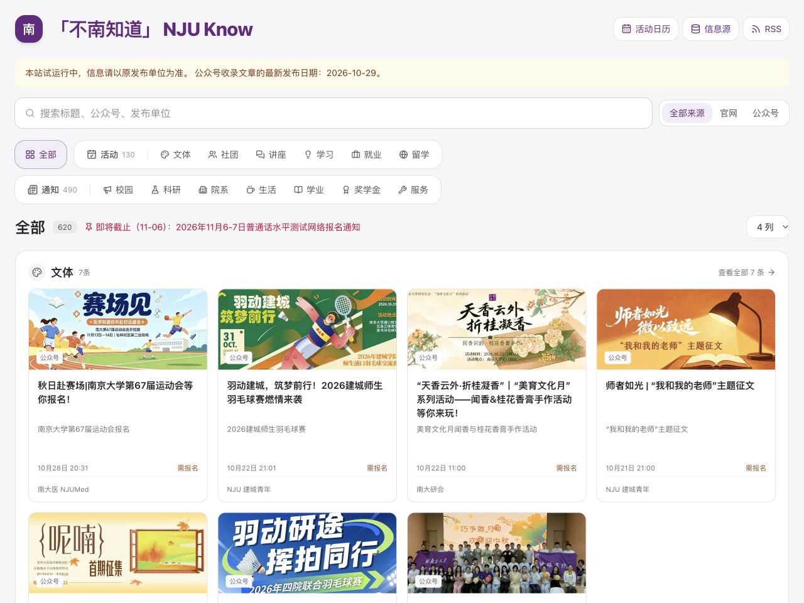

# 南大知道 · NJU Know

[](https://github.com/ZhangYitian-world/nju-know/actions/workflows/deploy.yml)

把分散在南京大学各院系官网与公众号的校园信息，整理到一个可搜索、可筛选、可订阅的页面。

**[访问网站](https://njuknow.zhangyitian.com/)** · [活动日历](https://njuknow.zhangyitian.com/calendar/) · [信息源与更新状态](https://njuknow.zhangyitian.com/sources/) · [RSS](https://njuknow.zhangyitian.com/rss.xml)



## 可以做什么

- **聚合校园信息**：接入教务处、图书馆、研究生院、信息化中心及 19 个学院的公开栏目，共 23 个官网来源；另配置 47 个公众号，包含原有的全部 45 个发布单位。
- **按需查找**：支持关键词搜索、官网／公众号渠道筛选，以及活动、通知下的 13 个细分类。
- **辅助分类与摘要**：DeepSeek 已完成真实接入；Jev 适配已实现，配置密钥后可与 DeepSeek 协作。没有密钥或判断不确定时使用规则分类。
- **合并重复信息**：按原文链接、规范化标题及保守的近似标题规则合并转载，保留各发布单位与原始链接。
- **适配电脑与手机**：等高卡片、统一封面与元信息位置，支持切换列数。
- **自动更新**：GitHub Actions 每 3 小时采集公众号、检查官网、分类并发布，不依赖个人电脑开机，提供来源状态、活动日历和 RSS。

活动分类：文体、社团、讲座、学习、就业、留学。

通知分类：校园、科研、院系、生活、学业、奖学金、服务。

## 当前状态与边界

截至 2026-10-29，官网抓取和 DeepSeek 分类／摘要已通过实际云端运行与部署验证。新公众号通道已取得 10 月 29 日的文章，并支持云端定时采集；旧来源保留为可选适配。采集依赖有效的微信读书授权，到期或受限时可能需要重新扫码，具体配置见[公众号采集说明](docs/wechat-local.md)。

本站为试运行的校园信息聚合项目，信息、截止时间与报名要求以原发布单位为准。模型读取公开标题、发布单位、日期和已有简介，并非始终读取文章全文；分类与摘要可能有误。去重采取保守策略，标题截断或大幅改写的转载仍可能重复出现。

## 本地运行

需要 Python 3.11+、Node.js 24 和 npm。Python 抓取及分类脚本使用标准库，不需要额外安装 Python 包。

```bash
git clone https://github.com/ZhangYitian-world/nju-know.git
cd nju-know
cd web
npm ci
npm run dev
```

打开 [http://localhost:3000](http://localhost:3000)。开发服务器会读取仓库中的现有数据；缺少模型密钥不影响前端启动。

需要刷新官网数据时，在仓库根目录运行：

```bash
python3 scraper.py
```

抓取会更新 `data/notices.json` 与 `data/source_status.json`，已有手动修改应先备份。查看完整的数据处理与前端说明，请参见 [web/README.md](web/README.md)。

## 模型与密钥

### GitHub Actions

在仓库 **Settings → Secrets and variables → Actions → Secrets** 添加所需密钥：

| Secret | 用途 | 是否必需 |
| --- | --- | --- |
| `DEEPSEEK_API_KEY` | 分类与简短事实摘要，默认 `deepseek-flash` | 可选；当前网站已启用 |
| `TYPESAFE_API_KEY` | Jev 封闭类别与报名判断，默认 `jev-1.14.0` | 可选；尚待真实验证 |
| `WECHAT_CLOUD_AUTH` | 用户授权的微信读书登录种子及授权缓存加密密钥 | 云端公众号采集时配置，不得公开 |
| `WERSS_AK`、`WERSS_SK` | 当前 WeRSS 采集服务的 API 身份凭据 | 使用该服务时配置 |

在 **Variables** 中设置 `CLASSIFIER_PROVIDER`，支持 `auto`、`hybrid`、`deepseek`、`jev`。当前使用 `hybrid`：

- 两个模型密钥都有：Jev 分类，DeepSeek 补摘要并判断 Jev 不确定的条目。
- 只有一个模型密钥：使用已配置的服务。
- 没有模型密钥：使用关键词规则，官网抓取与网站部署仍可运行。

配置后可在 **Actions → Build and Deploy → Run workflow** 手动更新，或等待下一轮定时任务。

### 本地使用

在仓库根目录参照 [.env.example](.env.example) 创建 `.env`，添加需要的变量；不要覆盖已有凭据，也不要提交真实密钥。

本地直接执行 Python 不会自动读取 `.env`。在自己的终端加载后再运行：

```bash
set -a
. ./.env
set +a
python3 fetch_wechat.py
python3 enrich_llm.py
```

GitHub Secrets 与本地 `.env` 相互独立，不会自动同步。官网抓取本身不需要大模型密钥。已有的 `publish.sh` 用于本地定时抓取、分类、提交和推送，运行前应检查当前暂存区及远程配置。

## 自动更新与数据流

```text
官网公开栏目 ── scraper.py ────── data/notices.json ──┐
云端公众号 ── collect_wechat_cloud.py ─ data/wechat.json ┤
                                                    ↓
                                              enrich_llm.py
                                                    ↓
                                               data/llm.json
                                                    ↓
                                      校验缓存 → 分类 → 合并来源
                                                    ↓
                                         Next.js → web/out/
                                                    ↓
                                             GitHub Pages
```

官网与模型结果通过独立的 Actions Cache 在运行之间保存。单个来源失败时保留其未过期内容；模型失败时回退规则。模型缓存包含输入指纹、版本、提供方和模型名，未变化的文章不重复调用；低置信度也会缓存。每轮最多处理 100 条，未完成的内容在后续轮次继续处理。

定时运行可能因 GitHub 排队而延迟；长期无仓库活动也可能导致定时工作流停用，可在 Actions 页面检查和恢复。

## 构建与检查

在仓库根目录运行分类、解析及缓存回退检查：

```bash
python3 -m unittest discover -s tests -v -b
node --experimental-strip-types --test tests/*.test.mjs
```

构建静态站点并预览：

```bash
cd web
npm ci
npm run build
python3 -m http.server 3123 --bind 127.0.0.1 --directory out
```

当前独立域名部署在根路径，不设置 Next.js `basePath`。若改为默认 GitHub 项目站 `https://zhangyitian-world.github.io/nju-know/`，需要同步配置 `basePath: "/nju-know"`、站点 URL 与链接后重新构建。

## 项目结构

```text
.github/workflows/deploy.yml  抓取、测试、分类、构建与部署
official_sources.json        扩展官网来源及公开栏目配置
scraper.py                   官网抓取、过期过滤和来源状态
source_parsers.py            官网 HTML / 嵌入 JSON 列表解析
fetch_wechat.py              可选的旧公众号 API / RSS 适配
collect_wechat_local.py      本机微信读书采集与安全元数据导出
collect_wechat_cloud.py      云端采集、授权隔离和加密缓存
wechat_sources.json          已迁移的公众号公开标识与名称
wechat_login.py              仅在本机开放的扫码登录页
enrich_llm.py                模型分类、摘要与版本化缓存
data/                       抓取数据与模型结果
tests/                      抓取、分类、去重和回退检查
web/                        Next.js / React / TypeScript 前端
```

新增官网来源可以参考 `official_sources.json`，优先接入无需登录的公开栏目，并为新的页面结构补充解析样例。反馈分类错误或重复内容时，请附原文链接和预期分类。

## 致谢与内容归属

产品形态与分类体系参考 [「北大知道」PKU Know](https://pkuknow.cn)，开发：**涂增基**，合作贡献：**杨宣风、时豪**，在此致谢。

本站为独立实现，未使用其源码、接口或视觉素材；PKU Know 未公开源码，也未声明许可证。

校园通知与公众号文章的内容版权归原发布单位和作者所有。本站展示来源并保留原文链接，具体信息请以原文为准。

本机公众号通道使用 [wechatAutoRSSTool](https://github.com/x554960766/wechatAutoRSSTool) 的采集模块，感谢该项目作者；独立安装目录中保留其原始许可证。
